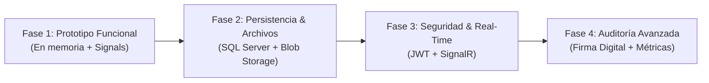

# 📄 Informe Técnico y Ejecutivo: Sistema DocControl
**Control de Versiones Documental Empresarial (.NET 10 + Angular 21)**  
* **Folio de Documento:** `DOC-INF-001`  
* **Fecha de Emisión:** 07 de Noviembre de 2026  
* **Estado:** Prototipo Funcional Completo  

---

## 1. Resumen Ejecutivo del Proyecto
**DocControl** es una plataforma empresarial diseñada para la gestión integral del ciclo de vida, concurrencia e integridad de documentos ofimáticos (`Word`, `Excel`, `PowerPoint` y `PDF`) en entornos colaborativos corporativos.

El sistema implementa un modelo de concurrencia pesimista controlada denominado **"Single-Editor Lock & Lease"** (Bloqueo de Editor Único con Concesión Temporal), articulado con un **Control de Acceso Basado en Roles (RBAC)** y una **Bitácora Digital de Auditoría Inmutable** alineada con los estándares de control documental físico.

### Arquitectura de Monorepo Desacoplado:
* **Backend:** .NET 10 Web API (C#) con servicio de persistencia en memoria y mecanismos de sincronización multihilo (*thread-safe*).
* **Frontend:** Angular 21 (*Standalone Components*, *Signals* reactivos y nueva sintaxis de control de flujo), configurado con proxy reverso corporativo.

---

## 2. Alcance y Funcionalidades Detalladas (¿Qué hace y cómo lo hace?)

### A. Soporte de Formatos Empresariales
* **Formatos cubiertos:** Word (`.docx`), Excel (`.xlsx`), PowerPoint (`.pptx`) y PDF (`.pdf`).
* Identificación visual inmediata mediante código de color, icono representativo y extensión de archivo.

### B. Control de Acceso Basado en Roles (RBAC)
El sistema define tres perfiles con responsabilidades estrictas:
1. **Lector:** Acceso exclusivo a consulta de catálogo e historial de versiones.
2. **Editor:** Facultado para realizar Check-out (bloqueo), extender tiempo y publicar nuevas versiones (Check-in).
3. **Administrador:** Posee todos los permisos de Editor y la facultad exclusiva de realizar Desbloqueos Forzados (*Force-Unlock*).

> **Mecanismo de Implementación:**
> * **Frontend:** Simulador de identidad integrado en la barra de navegación que permite alternar entre usuarios en tiempo real. Las acciones y botones se habilitan o restringen mediante señales computadas (`computed`).
> * **Backend:** Los controladores validan el rol recibido en cada solicitud contra el enumerador de roles; si la operación no corresponde al perfil, se rechaza con código HTTP `400 Bad Request`.

### C. Bloqueo de Editor Único con Expiración (Single-Editor Lock & Lease)
Mecanismo diseñado para erradicar la sobreescritura accidental y la pérdida de cambios por concurrencia desordenada.
* **Check-out (`POST /api/documents/{id}/lock`):**
  * Asigna el documento al usuario solicitante con una vigencia de **30 minutos**.
  * Si otro usuario intenta bloquear el mismo documento, el servidor retorna **`409 Conflict`**, indicando el usuario titular y la hora exacta de expiración.
* **Extensión de Arrendamiento (`POST /api/documents/{id}/extend-lock`):**
  * El titular del bloqueo puede adicionar **15 minutos** adicionales antes del vencimiento.
* **Desbloqueo Forzado (`POST /api/documents/{id}/force-unlock`):**
  * Exclusivo para Administradores ante bloqueos desatendidos o emergencias operativas.
  * Exige justificación/motivo obligatorio, el cual queda asentado en la auditoría.
* **Autocaducidad de Bloqueos:**
  * En cada consulta, el servicio evalúa el vencimiento temporal (`DateTime.UtcNow > FechaExpiracion`).
  * Los bloqueos expirados se liberan automáticamente sin requerir intervención manual.

### D. Versionado e Integridad Criptográfica (Check-in)
* **Check-in (`POST /api/documents/{id}/checkin`):**
  * Valida la titularidad del bloqueo activo.
  * Admite incremento de versión menor (`v1.0` -> `v1.1`) o mayor (`v1.x` -> `v2.0`).
  * Exige un comentario de cambios obligatorio.
  * Calcula un **Hash SHA-256** único derivado de los metadatos y contenido para garantizar la no alteración del documento.
  * Inserta el registro en el historial y libera el bloqueo automáticamente.

### E. Hoja de Bitácora Digital de Auditoría
* Registro cronológico e inmutable de cuatro acciones clave:
  1. `BLOQUEO_EDICION`
  2. `EXTENSION_TIEMPO`
  3. `NUEVA_VERSION`
  4. `DESBLOQUEO_FORZADO`
* **Atributos capturados:** Folio consecutivo, Fecha/Hora UTC exacta, Usuario, Rol, Código de Documento, Nombre, Versión y Observaciones/Justificación.

---

## 3. Matriz de Ventajas y Desventajas

### Ventajas de la Arquitectura Actual
1. **Compilación Limpia y Cero Dependencias Externas:** No requiere paquetes npm de terceros ni bibliotecas NuGet adicionales; utiliza C# nativo y CSS moderno sin riesgo de incompatibilidades en compilación.
2. **Rendimiento y Seguridad Concurrente:** Uso de cerrojos exclusivos (`lock`) en C# que evitan condiciones de carrera (*race conditions*) y garantizan operaciones atómicas en memoria.
3. **Reactividad Avanzada con Angular Signals:** Gestión de estado óptima sin sobrecargar el ciclo de detección de cambios de Zone.js, proporcionando una experiencia de usuario fluida e instantánea.
4. **Trazabilidad Total:** Imposibilidad de realizar modificaciones anónimas; todo cambio queda indexado por folio en la bitácora corporativa.
5. **Simulador de Sesión Integrado:** Herramienta de pruebas que permite validar la matriz RBAC y los bloqueos concurrentes en una misma sesión sin reiniciar la aplicación.

### Desventajas y Limitaciones del Prototipo
1. **Persistencia Volátil en Memoria:** Al reiniciar el proceso de la API de .NET, los datos vuelven a su estado base y se pierden las versiones o bitácoras generadas durante la sesión.
2. **Gestión Lógica de Archivos (Sin Binarios Reales):** El prototipo procesa nombres, metadatos y cálculo de hash, pero no almacena los archivos físicos (*blobs*) en disco ni en almacenamiento en la nube.
3. **Autenticación Simulada desde el Cliente:** La identidad del usuario se transmite en el payload de las solicitudes en lugar de ser validada a través de un token criptográfico firmado (`JWT / OAuth2`).
4. **Escalabilidad Horizontal Restringida:** Al depender de memoria local del servidor, no puede desplegarse en múltiples instancias (*cluster*) sin una capa de persistencia compartida.

---

## 4. Posibles Errores y Riesgos Operativos

| Riesgo Operativo | Causa Raíz | Mitigación Recomendada |
| :--- | :--- | :--- |
| **Pérdida de datos por reinicio** | Estado almacenado en memoria RAM (`List<Documento>`). | Implementar Entity Framework Core con SQL Server o PostgreSQL. |
| **Desfase de Zona Horaria (*Timezone Skew*)** | Desincronización horaria entre cliente y servidor. | Manejo estricto de timestamps en formato UTC (`DateTime.UtcNow`). |
| **Suplantación en API Abierta** | Ausencia de firmas criptográficas en las peticiones. | Integrar autenticación JWT con claims validados en middleware. |
| **Bloqueo Innecesariamente Prolongado** | Desconexión abrupta de usuario con bloqueo activo. | Ya mitigado por el TTL de 30 minutos y el *Force-Unlock* por Administrador. |

---

## 5. Recomendaciones de Ingeniería

1. **Implementación de JWT (JSON Web Tokens):** Reemplazar el envío manual de usuario y rol por encabezados `Authorization: Bearer`, extrayendo las credenciales de los Claims del token validado por el servidor.
2. **Persistencia Relacional con Entity Framework Core:** Mapear las entidades existentes a tablas en SQL Server o PostgreSQL, asegurando durabilidad transaccional (ACID).
3. **Almacenamiento Físico de Archivos:** Incorporar soporte para `IFormFile` / `multipart-form-data` y almacenar los archivos binarios en servicios como Azure Blob Storage, Amazon S3 o SAN local.
4. **Actualización en Tiempo Real con SignalR:** Habilitar WebSockets para que las acciones de bloqueo y liberación se reflejen inmediatamente en las pantallas de todos los usuarios sin requerir recarga.
5. **Exportación de Bitácora a Formatos Formales:** Añadir generador de reportes en PDF y Excel para cumplimiento de auditorías físicas y normativas de calidad (ISO 9001 / NOMs aplicables).

---

## 6. Plan de Evolución y Próximos Pasos (Roadmap)

* **Fase 1 (Completada):** Prototipo funcional completo con modelos de dominio, servicio en memoria, controlador REST, interfaz reactiva, RBAC y auditoría.
* **Fase 2 (Corto Plazo - Persistencia y Archivos):** Conectar `AppDbContext` con SQL Server mediante migraciones de EF Core y habilitar carga/descarga física de archivos binarios.
* **Fase 3 (Mediano Plazo - Seguridad y Colaboración):** Integrar ASP.NET Core Identity y autenticación JWT con *refresh tokens*, más SignalR para sincronización bidireccional en vivo.
* **Fase 4 (Largo Plazo - Auditoría y Analítica):** Módulo de exportación de reportes certificados con firma digital y dashboard de métricas avanzadas.

