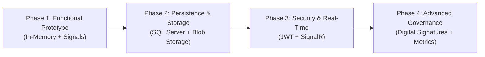

# 📄 Technical and Executive Report: DocControl System
**Enterprise Document Version Control System (.NET 10 + Angular 21)**  
* **Document Reference:** `DOC-INF-001`  
* **Publication Date:** November 07, 2026  
* **Status:** Complete Functional Prototype  

---

## 1. Executive Summary
**DocControl** is an enterprise-grade software platform engineered to govern the lifecycle, concurrency, and integrity of corporate office documents (`Word`, `Excel`, `PowerPoint`, and `PDF`) in collaborative environments.

The architecture enforces a controlled pessimistic concurrency pattern known as **"Single-Editor Lock & Lease"**, combined with **Role-Based Access Control (RBAC)** and an **Immutable Digital Audit Log** patterned after formal corporate physical record-keeping standards.

### Decoupled Monorepo Architecture:
* **Backend:** .NET 10 Web API (C#) featuring an in-memory thread-safe singleton workspace service.
* **Frontend:** Angular 21 utilizing Standalone Components, reactive Signals, and native modern control flow syntax (`@if`, `@for`), interfaced through an enterprise reverse proxy configuration.

---

## 2. Scope and Core Capabilities (What It Does and How It Does It)

### A. Enterprise File Format Support
* **Formats covered:** Word (`.docx`), Excel (`.xlsx`), PowerPoint (`.pptx`), and PDF (`.pdf`).
* Instant visual categorization featuring dedicated color-coded badges, contextual icons, and document classification codes.

### B. Role-Based Access Control (RBAC)
The platform establishes three clearly delineated user roles:
1. **Reader (*Lector*):** Read-only access to browse the catalog and inspect version history.
2. **Editor:** Authorized to acquire exclusive check-out locks, extend active lease periods, and commit new revisions (Check-in).
3. **Administrator:** Retains full Editor privileges plus exclusive authority to execute emergency administrative unlocks (*Force-Unlock*).

> **Implementation Details:**
> * **Frontend:** Interactive session simulator in the top corporate navbar that dynamically alters identity and privileges in real time. Interface buttons and interactions are conditionally enabled through computed signals (`computed`).
> * **Backend:** API endpoints strictly parse incoming role designations against defined enums; unauthorized requests are rejected immediately with `HTTP 400 Bad Request`.

### C. Single-Editor Lock & Lease with Automatic Expiration
Designed to eliminate overwrite conflicts (*"last write wins"*) and document corruption.
* **Check-out (`POST /api/documents/{id}/lock`):**
  * Grants the requesting user an exclusive editing lease for **30 minutes**.
  * Competing lock requests on an active lease trigger an **`HTTP 409 Conflict`**, specifying the current owner and exact expiration timestamp.
* **Lease Extension (`POST /api/documents/{id}/extend-lock`):**
  * The legitimate lock owner can extend the editing window by **+15 minutes** prior to expiration.
* **Force-Unlock (`POST /api/documents/{id}/force-unlock`):**
  * Administrator-only capability to recover orphaned or neglected document locks.
  * Enforces a mandatory justification note that is recorded in the immutable audit log.
* **Autonomous Lease Expiration:**
  * The workspace service evaluates lease validity (`DateTime.UtcNow > ExpirationDate`) upon every query, automatically releasing expired locks without requiring manual sweeps.

### D. Version Control and Cryptographic Integrity (Check-in)
* **Check-in (`POST /api/documents/{id}/checkin`):**
  * Validates active lock ownership prior to submission.
  * Supports semantic version bumps: minor revisions (`v1.0` -> `v1.1`) or major revisions (`v1.x` -> `v2.0`).
  * Requires a detailed change description log.
  * Generates a unique **SHA-256 hash** derived from the metadata and payload to certify document authenticity and tamper resistance.
  * Archives the revision into the historical log and automatically releases the document lock.

### E. Immutable Digital Audit Trail
* Tracks four critical governance events:
  1. `BLOQUEO_EDICION` (Edit Lock Acquired)
  2. `EXTENSION_TIEMPO` (Lease Duration Extended)
  3. `NUEVA_VERSION` (New Revision Committed)
  4. `DESBLOQUEO_FORZADO` (Administrative Force-Unlock)
* **Captured Data Fields:** Sequential Tracking Folio, Exact UTC Timestamp, User Name, Role, Document Code, Document Title, Version Reference, and Justification/Notes.

---

## 3. Architectural Strengths and Advantages

### Key Advantages
1. **Clean Build and Zero Dependency Overhead:** Built strictly using native C# capabilities and clean modern CSS; avoids third-party npm component bloat and fragile NuGet packages for guaranteed compilation.
2. **Thread-Safe Concurrency Architecture:** Utilizes internal synchronization primitives (exclusive monitor locks `lock`) in C# to ensure atomic operations and eliminate race conditions in memory.
3. **High-Performance Reactivity with Angular Signals:** Optimized change detection that bypasses unnecessary digest cycles, resulting in fluid rendering and instantaneous UI state synchronization.
4. **Comprehensive Operational Traceability:** Zero tolerance for unrecorded operations; every state change is indexed by a unique folio number within the enterprise audit log.
5. **Built-in Multi-User Simulator:** Enables testers and stakeholders to validate RBAC policies and concurrency locks across distinct profiles within a single browser session without restarts.

### Prototype Drawbacks and Current Limitations
1. **Volatile In-Memory Storage:** Restarting the .NET backend process resets all state to initial seed records, erasing newly committed versions and audit records created during runtime.
2. **Metadata-Only File Handling (No Physical Blobs):** The prototype tracks filenames, metadata, and cryptographic hashes, but does not persist the underlying binary files to disk or object storage.
3. **Client-Supplied Identity (Simulated Auth):** User identification and role claims are supplied inside the HTTP payload rather than extracted from signed cryptographic tokens (`JWT / OAuth2`).
4. **Restricted Horizontal Scalability:** Because the state resides in process memory, running multiple backend replicas behind a load balancer is currently not viable without an external distributed store.

---

## 4. Potential Risks and Failure Modes

| Operational Risk | Root Cause | Recommended Mitigation |
| :--- | :--- | :--- |
| **Data loss on server restart** | Volatile in-memory collections (`List<Documento>`). | Implement Entity Framework Core backed by SQL Server or PostgreSQL. |
| **Client/Server timezone discrepancies** | Inconsistent timezone handling across heterogeneous clients. | Enforce strict UTC timestamps (`DateTime.UtcNow`) at the backend layer. |
| **Role spoofing on unprotected endpoints** | Lack of cryptographic signature validation in API payloads. | Require signed Bearer JWTs with claims validated via middleware. |
| **Prolonged document lockouts** | Abrupt client disconnection while holding an active lock. | Mitigated by the 30-minute lease TTL and administrative *Force-Unlock*. |

---

## 5. Engineering Recommendations

1. **Implement JWT (JSON Web Tokens) Authentication:** Transition from body-based identity to standard `Authorization: Bearer` headers, deriving identity and role permissions directly from validated token claims.
2. **Relational Persistence via Entity Framework Core:** Map the domain entities to SQL Server or PostgreSQL with automated migrations, guaranteeing ACID transactional durability.
3. **Binary File Storage Infrastructure:** Incorporate `multipart/form-data` support and stream binary uploads into Azure Blob Storage, AWS S3, or secure local Network-Attached Storage (NAS).
4. **Real-Time Synchronization via SignalR:** Establish WebSockets communication to push lock, unlock, and check-in updates instantly to all connected clients without polling or manual refreshes.
5. **Certified Audit Export Formats:** Introduce PDF and Excel export routines for audit logs to satisfy compliance and quality framework standards (ISO 9001 / SOC 2).

---

## 6. Evolutionary Roadmap and Next Steps

* **Phase 1 (Completed):** Full functional prototype featuring domain entities, thread-safe memory service, RESTful controllers, reactive UI, RBAC simulation, and digital audit trail.
* **Phase 2 (Near-Term - Persistence & Binary Files):** Wire up `AppDbContext` with SQL Server using EF Core migrations and enable physical upload and download of binary documents (`.docx`, `.xlsx`, `.pdf`).
* **Phase 3 (Mid-Term - Enterprise Security & Real-Time):** Integrate ASP.NET Core Identity with JWT and refresh token mechanisms, and implement SignalR hubs for real-time document status broadcasts.
* **Phase 4 (Long-Term - Advanced Governance & Analytics):** Automated compliance report generation with digital signatures and executive dashboards tracking document turnaround times, lock durations, and revision frequency.

