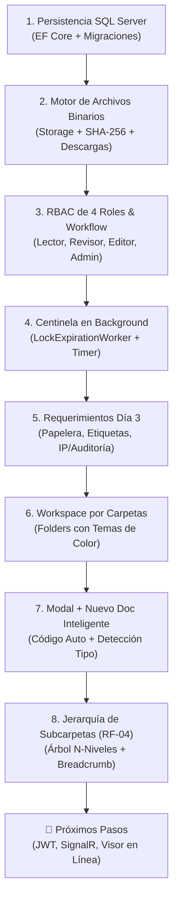
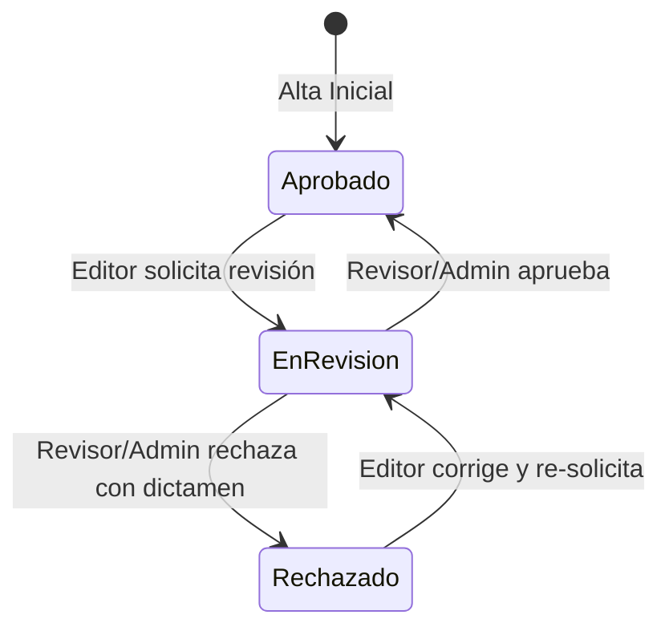

# 📋 Bitácora Técnica de Cambios y Evolución del Sistema
## DocControl — Sistema de Control de Versiones Documental Empresarial (.NET 10 + Angular 21 + SQL Server)

* **Folio de Documento:** `DOC-CHG-002`  
* **Fecha de Emisión:** 18 de Noviembre de 2026  
* **Versión del Sistema:** v2.5.0 (Edición Corporativa con Jerarquía Multinivel)  
* **Estado Actual:** 100% Funcional, Compilación Validada (0 Errores, 0 Advertencias)  

---

## 1. Resumen Ejecutivo y Secuencia de Evolución

El presente documento constituye la **Bitácora Integral de Ingeniería y Registro de Cambios** del sistema **DocControl**. Detalla de forma cronológica, exhaustiva y pedagógica cada una de las fases implementadas sobre la plataforma, explicando para cada hito:
1. **🎯 Lo que se hizo:** Resumen funcional del requerimiento y valor entregado.
2. **📐 Cómo se hizo (Nivel Teórico / Arquitectura):** Fundamento de ingeniería de software, patrones de diseño, reglas de negocio y restricciones relacionales.
3. **💻 Cómo se hizo (Explicación Práctica con Ejemplos):** Fragmentos reales de código (.NET 10 / Angular 21), payloads JSON/multipart, respuestas HTTP y registros de auditoría generados.



---

## 2. Bitácora Cronológica de Cambios Implementados

```
Leyenda de Tags:
[BACKEND] = Cambios en DocControl.Api (.NET 10)
[FRONTEND] = Cambios en interfaz reactiva (Angular 21)
[DATABASE] = Migraciones y esquemas relacionales en SQL Server
[SECURITY] = Auditoría inmutable y control de acceso RBAC
```

---

### 🔹 Hito 1: Persistencia Relacional y Migración a SQL Server con EF Core
`[BACKEND]` `[DATABASE]`

#### 1. 🎯 Lo que se hizo
Se migró la arquitectura inicial (que operaba con colecciones volátiles en memoria RAM) a una base de datos relacional empresarial con **SQL Server**, orquestada mediante **Entity Framework Core 10**. Se crearon los esquemas de tablas, índices de unicidad, control de concurrencia optimista y siembra inicial de datos (*seeding*).

#### 2. 📐 Cómo se hizo (Nivel Teórico / Arquitectura)
* **Garantía ACID (Atomicidad, Consistencia, Aislamiento y Durabilidad):** Toda operación de check-out, check-in o cambio de metadatos se ejecuta en transacciones relacionales duraderas.
* **Manejo de Concurrencia Optimista con `RowVersion`:** Se implementó una columna `byte[] RowVersion` con la convención `[Timestamp]` en la entidad `Documento`. Si dos usuarios intentan bloquear o editar el mismo documento simultáneamente, el motor de base de datos detecta el desfase de versión y arroja un `DbUpdateConcurrencyException`, impidiendo sobreescrituras ciegas.
* **Relaciones Uno a Muchos y Uno a Uno:** `Documento` tiene una relación 1:N con `VersionDocumento` (borrado en cascada configurado) y 1:1 opcional con `InfoBloqueo`.
* **Migraciones Versionadas:** Toda mutación del esquema se genera mediante comandos de dotnet CLI (`dotnet ef migrations add`), evitando discrepancias entre entornos.

#### 3. 💻 Cómo se hizo (Explicación Práctica con Ejemplos)
* **Configuración del DbContext (`AppDbContext.cs`):**
```csharp
modelBuilder.Entity<Documento>(entity =>
{
    entity.HasKey(d => d.Id);
    entity.Property(d => d.Codigo).IsRequired().HasMaxLength(30);
    entity.HasIndex(d => d.Codigo).IsUnique(); // Código documental único
    entity.Property(d => d.RowVersion).IsRowVersion(); // Concurrencia optimista
    
    entity.HasMany(d => d.HistorialVersiones)
          .WithOne()
          .HasForeignKey(v => v.DocumentoId)
          .OnDelete(DeleteBehavior.Cascade);
          
    entity.HasOne(d => d.Bloqueo)
          .WithOne()
          .HasForeignKey<InfoBloqueo>(b => b.DocumentoId)
          .OnDelete(DeleteBehavior.Cascade);
});
```

* **Ejemplo de Consulta Segura con Transacción:**
```csharp
var doc = await _context.Documentos
    .Include(d => d.Bloqueo)
    .Include(d => d.HistorialVersiones)
    .FirstOrDefaultAsync(d => d.Id == id);
```

---

### 🔹 Hito 2: Motor de Archivos Físicos Binarios, Criptografía SHA-256 y Descargas
`[BACKEND]` `[FRONTEND]` `[SECURITY]`

#### 1. 🎯 Lo que se hizo
Se incorporó el almacenamiento real de archivos físicos en el servidor. Al realizar un **Check-in**, el sistema recibe el archivo binario (`.docx`, `.xlsx`, `.pptx` o `.pdf`), calcula en tiempo real su **Hash criptográfico SHA-256**, lo guarda físicamente en un directorio seguro `Storage/` con un nombre sanitizado y permite su **descarga** con el MIME type oficial correspondiente.

#### 2. 📐 Cómo se hizo (Nivel Teórico / Arquitectura)
* **Sanitización de Nombres de Archivo:** Se remueven caracteres peligrosos del nombre original (`..`, `/`, `\`, caracteres de control) y se construye un nombre único determinista:
  $$\text{NombreFisico} = \{\text{idDocumento}\}\_\text{v}\{\text{nuevaVersion}\}\_\{\text{nombreSanitizado}\}$$
* **Cálculo de Hash SHA-256 en Streaming:** En lugar de cargar todo el archivo en memoria RAM, se lee mediante un `FileStream` por bloques de bytes a través de `System.Security.Cryptography.SHA256`. Esto garantiza escalabilidad con archivos pesados.
* **Descarga Streaming:** El endpoint de descarga lee el archivo desde el disco y retorna un `FileStreamResult` con encabezados HTTP `Content-Disposition: attachment; filename="..."` y el MIME type adecuado.

#### 3. 💻 Cómo se hizo (Explicación Práctica con Ejemplos)
* **Guardado y Hashing en Backend (`DocumentsController.cs`):**
```csharp
private async Task<string> GuardarArchivoAsync(IFormFile archivo, string nombreAlmacenado)
{
    Directory.CreateDirectory(_storagePath);
    var rutaCompleta = Path.Combine(_storagePath, nombreAlmacenado);

    using var sha256 = SHA256.Create();
    await using var streamDestino = new FileStream(rutaCompleta, FileMode.Create, FileAccess.Write, FileShare.None);
    await using var uploadStream = archivo.OpenReadStream();

    // Se calcula el hash leyendo el flujo en tiempo real
    byte[] hashBytes = await sha256.ComputeHashAsync(uploadStream);
    uploadStream.Position = 0; // Se rebobina para volcar al disco
    await uploadStream.CopyToAsync(streamDestino);

    return Convert.ToHexString(hashBytes).ToLowerInvariant();
}
```

* **Descarga con MIME Type Correcto:**
```csharp
[HttpGet("{id}/download/{versionId}")]
public async Task<IActionResult> DescargarArchivo(int id, int versionId)
{
    var version = await _context.VersionesDocumento
        .FirstOrDefaultAsync(v => v.DocumentoId == id && v.Id == versionId);

    if (version == null || string.IsNullOrEmpty(version.RutaArchivo))
        return NotFound(new { error = "Archivo no encontrado" });

    var rutaFisica = Path.Combine(_storagePath, version.RutaArchivo);
    if (!System.IO.File.Exists(rutaFisica))
        return NotFound(new { error = "El binario no existe en el disco" });

    var mime = ObtenerMimeType(Path.GetExtension(version.NombreArchivo));
    var stream = new FileStream(rutaFisica, FileMode.Open, FileAccess.Read, FileShare.Read);
    return File(stream, mime, version.NombreArchivo);
}
```

* **Llamada desde Angular (`app.component.ts`):**
```typescript
descargarVersion(v: VersionDocumento): void {
  this.http.get(`/api/documents/${v.documentoId}/download/${v.id}`, { responseType: 'blob' }).subscribe({
    next: (blob) => {
      const url = URL.createObjectURL(blob);
      const a = document.createElement('a');
      a.href = url;
      a.download = v.nombreArchivo;
      a.click();
      URL.revokeObjectURL(url);
    }
  });
}
```

---

### 🔹 Hito 3: Expansión de RBAC a 4 Roles Corporativos y Workflow de Revisión
`[BACKEND]` `[FRONTEND]` `[SECURITY]`

#### 1. 🎯 Lo que se hizo
Se evolucionó la matriz de permisos de 2 roles iniciales a **4 roles corporativos formales**: `Lector`, `Revisor`, `Editor` y `Administrador`. Además, se implementó el ciclo de vida de **Aprobación/Dictamen**, donde los documentos pueden pasar a estado `EnRevision`, ser evaluados por un Revisor y Dictaminados con comentarios formales.

#### 2. 📐 Cómo se hizo (Nivel Teórico / Arquitectura)
* **Matriz de Control de Acceso Basada en Roles (RBAC):**

| Funcionalidad / Operación | Lector | Editor | Revisor | Administrador |
| :--- | :---: | :---: | :---: | :---: |
| **Navegar carpetas y ver metadatos** | ✅ | ✅ | ✅ | ✅ |
| **Descargar archivos e historial** | ✅ | ✅ | ✅ | ✅ |
| **Bloqueo (Check-out) y Check-in** | ❌ | ✅ | ❌ | ✅ |
| **Extender concesión (+15 min)** | ❌ | ✅ | ❌ | ✅ |
| **Solicitar Revisión formal** | ❌ | ✅ | ❌ | ✅ |
| **Dictaminar (Aprobar / Rechazar)** | ❌ | ❌ | ✅ | ✅ |
| **Crear / Editar Carpetas y Subcarpetas**| ❌ | ❌ | ✅ | ✅ |
| **Alta de nuevos documentos** | ❌ | ✅ | ❌ | ✅ |
| **Desbloqueo Forzado (*Force-Unlock*)** | ❌ | ❌ | ❌ | ✅ |
| **Eliminar documentos** | ❌ | ❌ | ❌ | ✅ |

* **Máquina de Estados de Revisión:**


#### 3. 💻 Cómo se hizo (Explicación Práctica con Ejemplos)
* **Endpoint de Dictamen (`POST /api/documents/{id}/review`):**
```csharp
[HttpPost("{id}/review")]
public async Task<IActionResult> Dictaminar(int id, [FromBody] SolicitudDictamen solicitud)
{
    if (!TryParseRol(solicitud.Rol, out var rol)) return RolInvalido(solicitud.Rol);
    
    // Solo Revisor o Administrador pueden dictaminar
    if (rol != RolUsuario.Revisor && rol != RolUsuario.Administrador)
        return await DenegarAccesoAsync(solicitud.Usuario, rol, id, "dictaminar documentos");

    var doc = await CargarDocumentoAsync(id);
    if (doc.EstadoRevision != EstadoRevision.EnRevision)
        return Denegado("El documento no se encuentra en estado 'En Revisión'.");

    doc.EstadoRevision = solicitud.Aprobar ? EstadoRevision.Aprobado : EstadoRevision.Rechazado;
    doc.RevisadoPor = $"{solicitud.Usuario} ({rol})";
    doc.ComentarioRevision = solicitud.Comentario;

    RegistrarEnBitacora(solicitud.Usuario, rol, doc,
        solicitud.Aprobar ? AccionBitacora.REVISION_APROBADA : AccionBitacora.REVISION_RECHAZADA,
        $"Dictamen: {(solicitud.Aprobar ? "APROBADO" : "RECHAZADO")}. Obs: {solicitud.Comentario}");

    await _context.SaveChangesAsync();
    return Ok(new { mensaje = "Dictamen procesado correctamente." });
}
```

---

### 🔹 Hito 4: Servicio Centinela en Background (`LockExpirationWorker`) y Cronómetro en Vivo
`[BACKEND]` `[FRONTEND]`

#### 1. 🎯 Lo que se hizo
Se creó un servicio de segundo plano (*Background Worker*) que monitorea activamente la base de datos cada **30 segundos**. Si un usuario dejó un documento bloqueado y venció su tiempo de arrendamiento (*lease* de 30 minutos), el sistema libera el candado automáticamente y registra el evento `EXPIRACION_AUTOMATICA` en la bitácora. En el frontend, se integró un **cronómetro regresivo en vivo** por segundo (`MM:SS`) con alerta crítica si restan menos de 5 minutos.

#### 2. 📐 Cómo se hizo (Nivel Teórico / Arquitectura)
* **Patrón Singleton a Scoped (`IServiceScopeFactory`):** Un `BackgroundService` en ASP.NET Core es registrado como **Singleton**, pero `AppDbContext` es un servicio **Scoped**. Para evitar fugas de memoria o problemas de concurrencia de DbContext, el worker crea un nuevo scope (`_scopeFactory.CreateScope()`) en cada iteración.
* **`PeriodicTimer` Asíncrono:** Evita hilos bloqueados usando temporizadores de precisión moderna de .NET.
* **Reactividad en Angular con Signals:** Un único `setInterval` de 1 segundo actualiza una señal reactiva `ahora = signal<number>(Date.now())`. Las funciones `tiempoRestante()` y `segundosRestantes()` recalculan el delta en memoria sin disparar llamadas HTTP innecesarias.

#### 3. 💻 Cómo se hizo (Explicación Práctica con Ejemplos)
* **Worker en Backend (`Services/LockExpirationWorker.cs`):**
```csharp
public class LockExpirationWorker : BackgroundService
{
    private static readonly TimeSpan Intervalo = TimeSpan.FromSeconds(30);
    private readonly IServiceScopeFactory _scopeFactory;

    protected override async Task ExecuteAsync(CancellationToken stoppingToken)
    {
        using var timer = new PeriodicTimer(Intervalo);
        while (await timer.WaitForNextTickAsync(stoppingToken))
        {
            using var scope = _scopeFactory.CreateScope();
            var db = scope.ServiceProvider.GetRequiredService<AppDbContext>();

            var ahora = DateTime.UtcNow;
            var vencidos = await db.Documentos
                .Include(d => d.Bloqueo)
                .Where(d => d.Bloqueo != null && d.Bloqueo.FechaExpiracion <= ahora)
                .ToListAsync(stoppingToken);

            foreach (var doc in vencidos)
            {
                var usuario = doc.Bloqueo!.UsuarioBloqueador;
                var rol = doc.Bloqueo.RolBloqueador;
                
                db.Bloqueos.Remove(doc.Bloqueo);
                doc.Estado = EstadoDocumento.Disponible;

                db.Bitacora.Add(new RegistroBitacora {
                    Usuario = usuario,
                    Rol = rol.ToString(),
                    CodigoDocumento = doc.Codigo,
                    NombreDocumento = doc.Nombre,
                    Accion = AccionBitacora.EXPIRACION_AUTOMATICA.ToString(),
                    Observaciones = $"Bloqueo expiró automáticamente tras cumplirse el tiempo de concesión."
                });
            }
            await db.SaveChangesAsync(stoppingToken);
        }
    }
}
```

* **Cronómetro y Alerta en Frontend (`app.component.ts`):**
```html
<span class="status-badge status-locked"
      [class.status-critical]="segundosRestantes(doc.bloqueo?.fechaExpiracion) < 300">
  🔒 En edición por {{ doc.bloqueo?.usuario }}
  <br><small>⏱ {{ tiempoRestante(doc.bloqueo?.fechaExpiracion) }}</small>
</span>
```

---

### 🔹 Hito 5: Paquete de Requerimientos Día 3 (RF-06, RF-07, RF-10, RF-11, RF-14)
`[BACKEND]` `[SECURITY]`

#### 1. 🎯 Lo que se hizo
Se cubrieron 5 requerimientos funcionales estrictos del estándar empresarial:
* **RF-06:** Tamaño del archivo en bytes (`TamanoBytes`) y motivo del cambio (`MotivoCambio`) registrados en cada versión.
* **RF-07:** Trazabilidad de auditoría de máquina (`DatosMaquina`) capturando IP remota y User-Agent del navegador.
* **RF-10:** Papelera de reciclaje / Borrado lógico (*Soft-Delete* con `Eliminado` y `FechaEliminacion`).
* **RF-11:** Registro de auditoría para descargas de archivos (`DESCARGA_ARCHIVO`) y accesos denegados (`ACCESO_DENEGADO`).
* **RF-14:** Sistema de etiquetas o tags separadas por coma (`Etiquetas`) para categorización ágil.

#### 2. 📐 Cómo se hizo (Nivel Teórico / Arquitectura)
* **Soft-Delete Seguro:** Los documentos marcados como `Eliminado = true` se excluyen de la vista operativa habitual, pero se preservan en la base de datos para auditorías legales o posible restauración. Un documento eliminado no puede ser bloqueado ni alterado.
* **Auditoría de Máquina No Repudiable:** A través de `IHttpContextAccessor`, el sistema extrae automáticamente la IP (`HttpContext.Connection.RemoteIpAddress`) y el encabezado `User-Agent`, impidiendo que el cliente falsifique su origen físico.

#### 3. 💻 Cómo se hizo (Explicación Práctica con Ejemplos)
* **Captura de IP y User-Agent en Bitácora (`DocumentsController.cs`):**
```csharp
private string ObtenerDatosMaquina()
{
    var ip = HttpContext.Connection.RemoteIpAddress?.ToString() ?? "Desconocida";
    var userAgent = HttpContext.Request.Headers.UserAgent.ToString();
    if (userAgent.Length > 200) userAgent = userAgent[..200];
    return $"IP: {ip} | Agente: {userAgent}";
}
```

* **Modelo Enriquecido (`VersionDocumento.cs`):**
```csharp
public long TamanoBytes { get; set; } // Peso físico en bytes (RF-06)
public string MotivoCambio { get; set; } = string.Empty; // Justificación del cambio
public string HashSHA256 { get; set; } = string.Empty; // Integridad criptográfica
```

---

### 🔹 Hito 6: Rediseño a Sistema de Carpetas con 6 Colores Corporativos
`[BACKEND]` `[FRONTEND]` `[DATABASE]`

#### 1. 🎯 Lo que se hizo
Se transformó la vista plana de documentos en un **Workspace Documental basado en Carpetas (Folders)**. Cada carpeta posee un color corporativo elegido entre 6 opciones permitidas (`Rojo`, `Amarillo`, `Azul`, `Verde`, `Morado`, `Cian`), metadatos inmutables (`CreadoPor`, `FechaCreacion`) y la capacidad de mover archivos entre carpetas mediante un modal interactivo (`📂 Mover a...`).

#### 2. 📐 Cómo se hizo (Nivel Teórico / Arquitectura)
* **Separación de Responsabilidades:** Solo los roles directivos (**Administrador** y **Revisor**) tienen privilegios para crear o editar carpetas. Los roles operativos (**Editor** y **Lector**) pueden navegar sus contenidos y mover archivos (Editor/Admin).
* **Inmutabilidad de Metadatos de Creación:** Al editar una carpeta, el endpoint rechaza tajantemente cualquier intento de modificar `CreadoPor` o `FechaCreacion`, permitiendo únicamente actualizar el `Nombre` y el `Color`.
* **Sincronización en Cascada:** Si se renombra una carpeta, el controlador actualiza automáticamente el campo `Departamento` de todos los documentos contenidos.

#### 3. 💻 Cómo se hizo (Explicación Práctica con Ejemplos)
* **Entidad `Carpeta.cs`:**
```csharp
public class Carpeta
{
    public int Id { get; set; }
    public string Nombre { get; set; } = string.Empty;
    public string CreadoPor { get; set; } = string.Empty;
    public DateTime FechaCreacion { get; set; }
    public string Color { get; set; } = "Azul"; // Rojo, Amarillo, Azul, Verde, Morado, Cian
}
```

* **Paleta CSS Dinámica (`app.component.ts`):**
```css
.folder-theme-Azul {
  border-color: #BFDBFE;
  border-top-color: #2563EB;
  background: linear-gradient(180deg, #EFF6FF 0%, #FFFFFF 70%);
}
.folder-theme-Azul .folder-svg { color: #2563EB; }
```

---

### 🔹 Hito 7: Optimización y Automatización del Modal "+ Nuevo Documento"
`[FRONTEND]`

#### 1. 🎯 Lo que se hizo
Se optimizó la experiencia de usuario (UX) al crear documentos:
* El formulario se reordenó de manera lógica y secuencial.
* El campo **Código** se volvió de solo lectura y se calcula automáticamente en tiempo real.
* El **Archivo inicial v1.0** se convirtió en un campo obligatorio antes de permitir el envío.
* El **Tipo** de documento se detecta y bloquea de manera automática al inspeccionar la extensión del archivo subido (`.docx` $\rightarrow$ Word, `.xlsx` $\rightarrow$ Excel, `.pptx` $\rightarrow$ PowerPoint, `.pdf` $\rightarrow$ PDF).

#### 2. 📐 Cómo se hizo (Nivel Teórico / Arquitectura)
* **Algoritmo de Nomenclatura Documental Corporativa:**
  $$\text{Código} = \{\text{IniCarpeta}\}-\{\text{IniDoc}\}-\{\text{Consecutivo 3 Dígitos}\}$$
  * *IniCarpeta:* Extrae las iniciales de las palabras de la carpeta (ej. "Recursos Humanos" $\rightarrow$ `RH`, "Finanzas" $\rightarrow$ `FIN`).
  * *IniDoc:* Extrae las tres primeras letras del nombre del documento.
  * *Consecutivo:* Busca el número más alto en el catálogo activo y calcula el siguiente no colisionante.
* **Señales Computadas en Angular:** Uso de `computed()` para recalcular de forma reactiva el código y la etiqueta del tipo en cuanto el usuario teclea el nombre o adjunta un archivo.

#### 3. 💻 Cómo se hizo (Explicación Práctica con Ejemplos)
* **Función Computada del Código (`app.component.ts`):**
```typescript
codigoAutogenerado = computed(() => {
  const carpeta = this.nuevoDepartamento().trim();
  const nombre = this.nuevoNombre().trim();

  // Iniciales de carpeta
  const palabras = this.quitarAcentos(carpeta).split(/\s+/).filter(p => p.length > 0);
  let iniCarpeta = palabras.length >= 2 
    ? palabras.map(p => p[0]).join('').toUpperCase() 
    : (palabras[0]?.substring(0, 3).toUpperCase() || 'GEN');

  // Iniciales del documento
  const iniDoc = this.quitarAcentos(nombre).substring(0, 3).toUpperCase() || 'DOC';
  const consecutivo = (this.documentos().length + 1).toString().padStart(3, '0');

  return `${iniCarpeta}-${iniDoc}-${consecutivo}`; // Ej. RH-CON-007
});
```

---

### 🔹 Hito 8: Jerarquía Multinivel de Subcarpetas (RF-04) y Breadcrumb Interactivo
`[BACKEND]` `[FRONTEND]` `[DATABASE]`

#### 1. 🎯 Lo que se hizo
Se satisfizo el requerimiento corporativo **RF-04**, permitiendo crear **árboles de carpetas de profundidad ilimitada** (subcarpetas dentro de carpetas o dentro de otras subcarpetas). Se introdujo una **barra de navegación interactiva (Breadcrumb)** que permite saltar a cualquier nivel superior y un botón directo `⬅ Subir un nivel`.

#### 2. 📐 Cómo se hizo (Nivel Teórico / Arquitectura)
* **Estructura de Datos en Árbol Adyacente (*Adjacency List Model*):**
  * La entidad `Carpeta` incorpora la clave foránea recursiva y anulable `CarpetaPadreId` (`int?`). Si es `null`, la carpeta reside en el nivel raíz.
* **Índice Compuesto Único en SQL Server:**
  $$\text{Unique}(\text{Nombre}, \text{CarpetaPadreId})$$
  Esto permite que existan dos carpetas con el mismo nombre (ej. `"2026"` o `"Auditorías"`) siempre que pertenezcan a carpetas padre distintas (ej. `Finanzas / 2026` vs `Legal / 2026`), respetando a la vez la unicidad entre hermanas del mismo nivel.
* **Algoritmo de Resolución de Breadcrumb:**
  Dado el nodo actual $N$, se asciende por el puntero de punteros padre hasta llegar a la raíz con detección de ciclos mediante un conjunto de visitados:
  $$N_k \rightarrow N_{k-1} \rightarrow \dots \rightarrow N_{\text{raíz}}$$
* **Indización Visual en Modal de Traslado:**
  El selector de carpetas recorre el árbol con una búsqueda en profundidad (DFS) para mostrar la jerarquía indentada con prefijos visuales (`↳ 📁 Finanzas / Impuestos 2026`).

#### 3. 💻 Cómo se hizo (Explicación Práctica con Ejemplos)
* **Índice Compuesto en DbContext (`AppDbContext.cs`):**
```csharp
modelBuilder.Entity<Carpeta>(entity =>
{
    entity.HasKey(c => c.Id);
    entity.Property(c => c.Nombre).IsRequired().HasMaxLength(100);
    // Unicidad por nivel jerárquico
    entity.HasIndex(c => new { c.Nombre, c.CarpetaPadreId }).IsUnique();
});
```

* **Breadcrumb Reactivo en Angular (`app.component.ts`):**
```typescript
rutaBreadcrumb = computed<CarpetaInfo[]>(() => {
  const actual = this.carpetaAbierta();
  if (!actual) return [];
  const todas = this.carpetas();
  const ruta: CarpetaInfo[] = [];
  const visitados = new Set<number>();
  let cursor: CarpetaInfo | undefined = actual;

  while (cursor && !visitados.has(cursor.id)) {
    visitados.add(cursor.id);
    ruta.unshift(cursor); // Añade al inicio para ordenar de raíz a hoja
    cursor = cursor.carpetaPadreId != null
      ? todas.find(c => c.id === cursor!.carpetaPadreId)
      : undefined;
  }
  return ruta;
});
```

* **Plantilla HTML del Breadcrumb:**
```html
<nav class="folder-breadcrumb" aria-label="Ruta de navegación">
  <span class="breadcrumb-root" (click)="volverACarpetas()">🏠 Todas las carpetas</span>
  @for (item of rutaBreadcrumb(); track item.id; let isLast = $last) {
    <span class="breadcrumb-sep">/</span>
    @if (!isLast) {
      <span class="breadcrumb-item" (click)="entrarACarpeta(item)">📁 {{ item.nombre }}</span>
    } @else {
      <span class="breadcrumb-current">📁 {{ item.nombre }}</span>
    }
  }
</nav>
```

---

## 3. Matriz Consolidada de Acciones de Bitácora del Sistema

La siguiente tabla compila los **17 tipos de eventos inmutables** que el motor de auditoría registra de manera permanente en SQL Server:

| # | Acción (`AccionBitacora`) | Rol Responsable | Descripción del Evento | Metadatos Capturados |
| :-: | :--- | :--- | :--- | :--- |
| 1 | `BLOQUEO_EDICION` | Editor / Admin | Check-out exclusivo de documento por 30 minutos. | Usuario, Fecha, Vigencia UTC, Código. |
| 2 | `EXTENSION_TIEMPO` | Editor titular | Concesión de 15 minutos adicionales sobre el candado. | Minutos extendidos, Nueva Fecha UTC. |
| 3 | `NUEVA_VERSION` | Editor titular | Check-in con archivo físico, versión mayor/menor. | Hash SHA-256, Tamaño bytes, Comentario. |
| 4 | `DESBLOQUEO_FORZADO` | Solo Admin | Liberación administrativa forzada sin consentimiento. | Motivo obligatorio, Editor afectado. |
| 5 | `ALTA_DOCUMENTO` | Editor / Admin | Registro inicial de un documento con su versión v1.0. | Código autogenerado, Carpeta, Hash. |
| 6 | `BAJA_DOCUMENTO` | Solo Admin | Eliminación de un documento de la vista activa. | Código, Usuario que eliminó, Motivo. |
| 7 | `SOLICITUD_REVISION`| Editor / Admin | Pasa el documento a estado `EnRevision` para dictamen.| Código, Versión enviada a dictamen. |
| 8 | `REVISION_APROBADA` | Revisor / Admin| Dictamen aprobatorio formal emitido. | Dictamen, Observaciones obligatorias. |
| 9 | `REVISION_RECHAZADA`| Revisor / Admin| Dictamen reprobatorio con comentarios de corrección. | Observaciones, Usuario revisor. |
| 10| `EXPIRACION_AUTOMATICA`| Sistema (*Worker*)| Caducidad por inactividad tras 30 min sin check-in. | Editor que perdió el bloqueo, Fecha UTC. |
| 11| `RESTAURAR_VERSION` | Editor / Admin | Reversión de metadatos o archivo a versión anterior. | Versión origen, Versión destino. |
| 12| `RESTAURAR_PAPELERA`| Solo Admin | Recuperación de un documento enviado a soft-delete. | Código de documento, Fecha restauración. |
| 13| `ELIMINACION_DEFINITIVA`| Solo Admin | Purga física total de registros y archivos en disco.| Código, Archivos eliminados del storage. |
| 14| `DESCARGA_ARCHIVO` | Todos | Descarga de un binario físico de cualquier versión. | Versión descargada, IP, User-Agent. |
| 15| `ACCESO_DENEGADO` | Intentos no autorizados| Intento de ejecutar acción sin el rol requerido. | Rol usado, Operación denegada, IP. |
| 16| `MOVIMIENTO_CARPETA`| Editor / Revisor / Admin | Traslado de un documento entre carpetas/subcarpetas. | Ruta origen $\rightarrow$ Ruta destino completa. |
| 17| `ALTA_CARPETA` / `MODIFICACION_CARPETA`| Revisor / Admin | Creación o edición de nombre/color de folder. | Color asignado, Padre ID, Creador. |

---

## 4. Hoja de Ruta Técnica (Roadmap de Próximos Pasos)

A continuación se exponen las siguientes fases prioritarias de ingeniería para llevar a DocControl a nivel de producción bancaria o corporativa enterprise:

### 🚀 Próximo Paso 1: Autenticación Criptográfica con JWT y ASP.NET Core Identity
* **Diagnóstico actual:** La identidad del usuario se selecciona mediante un simulador en el cliente y viaja en el cuerpo de las peticiones HTTP.
* **Propuesta técnica:**
  1. Integrar **ASP.NET Core Identity** con soporte de contraseñas hasheadas (`Argon2id` o `PBKDF2`).
  2. Emitir tokens firmados **JWT (JSON Web Tokens)** con algoritmo `HMAC-SHA512` conteniendo los *Claims* de identidad y rol.
  3. Proteger los endpoints con atributos `[Authorize(Roles = "Administrador,Revisor")]`.
  4. Incorporar mecanismo de **Refresh Tokens** persistidos en SQL Server con rotación automática para sesiones seguras.

### 🚀 Próximo Paso 2: Sincronización en Tiempo Real con SignalR (WebSockets)
* **Diagnóstico actual:** El frontend sondea cada 1 segundo un timer local y recarga periódicamente datos al detectar expiraciones.
* **Propuesta técnica:**
  1. Crear un `DocControlHub : Hub` en el backend.
  2. Transmitir eventos instantáneos a todas las sesiones conectadas:
     * `DocumentoBloqueado(docId, usuario, expiraUtc)`
     * `DocumentoLiberado(docId)`
     * `NuevaCarpetaCreada(carpeta)`
  3. Eliminar la necesidad de refrescar la pantalla manualmente para ver cambios de colegas en tiempo real.

### 🚀 Próximo Paso 3: Visor y Previsualización de Archivos en Línea (In-Browser Preview)
* **Diagnóstico actual:** Para consultar un documento, el usuario debe descargarlo físicamente a su equipo local.
* **Propuesta técnica:**
  1. Integrar un visor de **PDF en línea** mediante `PDF.js` embebido en un modal seguro.
  2. Añadir soporte para renderizado en solo lectura de documentos Office (`.docx`, `.xlsx`, `.pptx`) mediante librerías de conversión del lado del servidor a formato HTML o PDF ligero.

### 🚀 Próximo Paso 4: Búsqueda Semántica / Full-Text y Filtros Avanzados
* **Diagnóstico actual:** Los documentos se exploran navegando por su estructura de carpetas.
* **Propuesta técnica:**
  1. Implementar un buscador global condebounce que busque simultáneamente por:
     * Código documental, nombre y extensión.
     * Etiquetas o Tags temáticos (`RF-14`).
     * Rango de fechas de creación o modificación.
  2. Indexar el texto plano extraído del interior de los documentos para búsqueda por contenido (*Full-Text Search* en SQL Server).

### 🚀 Próximo Paso 5: Firma Electrónica Avanzada y Exportación Certificada de Auditoría
* **Diagnóstico actual:** La bitácora se consulta en una tabla interactiva en pantalla.
* **Propuesta técnica:**
  1. Generación de actas de auditoría formal en formato **PDF corporativo** con folio y sellado de tiempo criptográfico (RFC 3161).
  2. Módulo de **Firma Digital (PKI / X.509)** para que las aprobaciones de dictamen cuenten con validez jurídica y no repudio.

---

*Documento técnico redactado, validado y archivado en la suite de documentación de DocControl.*  
*Fin de la Bitácora.*
